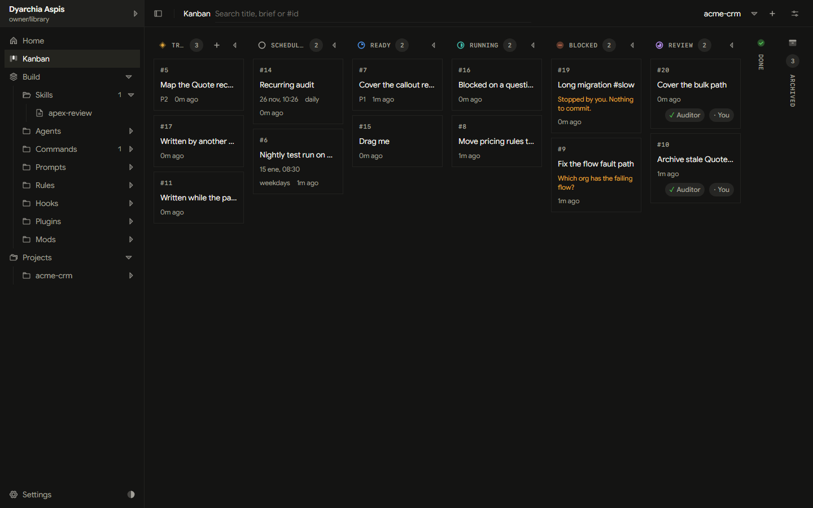
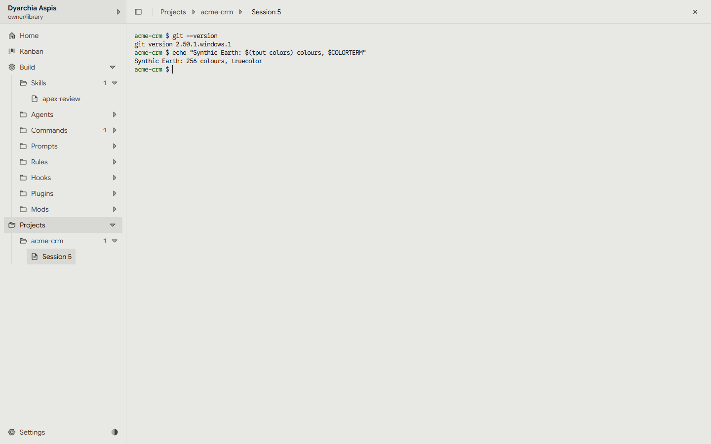

# Dyarchia Aspis

A desktop app for Windows that keeps your agent work in one place:

- **Kanban.** One board per project. Cards move from Triage to Done; Claude Code works on them, an auditor checks
  the result and you approve it.
- **Build.** Write skills, agents, prompts, commands, rules, hooks, plugins and mods with a guided tutorial, and
  publish them to a GitHub repository of yours as a pull request.
- **Projects.** Open a real terminal (Git Bash, PowerShell or cmd) in any project's folder, without leaving the app.

Dark and light themes, drawn with the Synthic design system.





> Alpha: it works, but things still change from one version to the next.

## Install

1. Open the [Releases page](https://github.com/Dyarchia/dyarchia-aspis/releases).
2. In the newest release, under **Assets**, click the file that ends in `x64-setup.exe` to download it.
3. Double-click the downloaded file.
4. Windows may show a blue window saying "Windows protected your PC". Click **More info**, then **Run anyway**.
   It appears because the installer is not signed by a known publisher; it is safe.
5. Click **Next** until it finishes. No administrator password is needed.
6. Open **Dyarchia Aspis** from the Start menu.

That is all. The app updates itself: when a new version is out, Settings offers to install it.

### Optional, to use everything

Each of these is a free download. Install them only if you want that part of the app:

- **Git for Windows** ([git-scm.com](https://git-scm.com/download/win)), for the Git Bash terminal in Projects.
- **GitHub CLI** ([cli.github.com](https://cli.github.com)), for Build. After installing it, open a terminal,
  run the command below once and follow the steps in the browser:

  ```powershell
  gh auth login
  ```

- **Claude Code** ([claude.com/claude-code](https://claude.com/claude-code)), for the agents that work the Kanban
  cards. In the app, open Settings and click **Wire it** next to it.

## Uninstall

Open Windows **Settings**, then **Apps**, find **Dyarchia Aspis** and click **Uninstall**.
